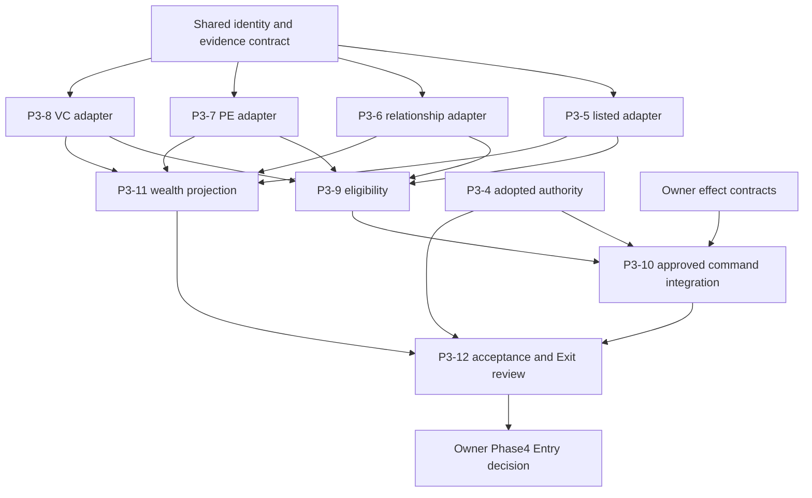

# Phase 3 Implementation Dependencies, Test and CI Plan

**DESIGN ONLY — no authority/production/merge authorization.** Baseline743d08d1867f453fe09c61e1fd5312c846cfc1eb, 2026-10-15 JST. Existing approved roadmap/entry/P3-3 take precedence. Proposed sequencing below is a technical recommendation, not amended formal phase authority.

## Current scheduling addendum (2026-10-16)

The merged [Implementation-First Roadmap v2](ECONOMIC_ENGINE_IMPLEMENTATION_FIRST_ROADMAP.md) and [gate alignment](PHASE_3_4_IMPLEMENTATION_FIRST_GATE_ALIGNMENT.md) control validation timing. References below to broad A–L/century/scale programs are Stage Q plans, not new prerequisites for every pure adapter or F Exit. Targeted independent writer-family review, financial safety/permanent gates and applicable final-HEAD CI remain Stage F requirements. `PHASE_3_F_EXIT` needs all mandatory functionality and Owner acceptance; Phase 4 production still requires a separate Entry decision. The Owner's 2026-10-16 instruction authorizes safe pure implementation; it does not grant unconditional merges/cutovers.

## 1. Implementation DAG and merge order

P3-9 may start with supported player evidence while family adapters mature, explicitly partial/unknown and non-executable. P3-11 raw component work may start early, but complete projection depends on all relevant holdings/liabilities/valuation evidence. B/C/D share an identity index, not recursive calls into each other: index builds raw reciprocal links first, adapters emit claims, final composition resolves cross-family aliases. No cycle in evaluation.

Recommended practical order: shared identity/types test seams → P3-5 listing index and P3-8 VC conversion (serial integration for shared file) → P3-7 fund/direct PE → P3-6 hierarchy/composition (needs PE/VC alias outputs) → P3-9 and P3-11 pure projections → P3-10 only after P3-4/effect approval → P3-12. Slice numbering is not the implementation scheduler. P3-4 Writer work can progress alongside pure adapter work without a competing ownership writer.

## 2. PR concerns and dependencies

| Proposed implementation PR | Concern / acceptance | Merge prerequisite | Estimate |
|---|---|---|---|
| S | shared pure source-index/types/validators without public behavior cutover; collision/purity/source-token fixtures | Owner approves implementation contract |1|
| A | P3-5 external account positions and aliases; unknown rights explicit | S |1|
| D | P3-8 current/pending round/IPO conversion; distinct accounts | S,A listing binding seam |1|
| C | P3-7 fund/LP/GP/co-invest and legacy direct holdings | S |1|
| B | P3-6 hierarchy/PE/VC mirror composition and cycle diagnostics | S,C,D |1–2|
| E | P3-9 exact pure eligibility with boundaries | S + supported input adapters |1|
| F | P3-11 component union and signed/partial wealth | A,B,C,D + selected valuation evidence |1|
| EU/FU | separate rights explanation / wealth display, no new writers | E/F + display approval |0–2|
| G | P3-10 guards, information view, proposal lifecycle, separately approved resolution families | P3-4,E + exact effect/receipt contracts |3–7+|
| H | P3-12 permanent assertions and acceptance evidence | all included implementations |2|

Planning estimate13–20+ implementation PRs excluding P3-4 remedial/authority work, debt fixes and any new unsupported issuer-class scope. Estimate is not hours or implementation approval. Docs delivery is9 concerns: shared architecture/dependencies/audit/readiness plus8 slice contracts; merges remain Owner-held. First merge shared docs, then slice docs; their companion plain filenames avoid claiming the other PR has already merged.

## 3. File ownership and safe concurrency

| Area | Primary editor / concurrent rule |
|---|---|
| js/engine.js, expansion.js, ma-* writers, save*/finance.js, Track A, P3-4 contracts | Claude Code P3-4 session; this task never edits |
| economic-read-model.js shared helpers/public exports | exactly one integration editor at a time; pure slice patches sequenced |
| future pure family helpers | can be separate files only after module-load contract review; update index/module fixture/cache requirements in that implementation PR |
| tests/run-all.js, run-all-shards.json, package.json, workflow registrations | serialize central integration; union registration entries, never discard another writer test |
| slice docs/new family-specific tests | independent review/work can proceed on nonoverlapping files |
| Phase4 #981 documents | existing owner/editor; cross-phase changes proposals only |

Claude retains P3-4 Writer repair/adoption; Work prepares pure contracts/adapters only when Owner later authorizes implementation, reviews diffs and evidence. Reviewer stage is separate from authoring; same-session agent review is labeled accordingly, never external independent. Publishing design slices does not authorize Work to compete with Claude's Writer authority.

## 4. Fast feedback versus final Gates

For pure adapter change: focused family Node tests + existing P3-1/2/read-model + purity/invalid/alias fixtures + link/static tests relevant to touched code; then canonical applicable CI. For activated Writer/command: RED/GREEN + installed chain, conservation, finance, all applicable save faults/reload/fresh hydration and RNG/replay tests before publishing. No financial fault test omitted to reduce latency.

One PR at a time through CI avoids queue pressure. Do not manually rerun a successful unchanged job. A new HEAD needs its own applicable CI; runtime-tree equality can reuse explicitly scoped characterization, never rename old CI evidence. If a real failure appears, diagnose before retry. Existing success→pending→cancelled behavior cannot be counted as green. Inspect main integration event and exact merged tree when a later separately authorized merge happens; no merge in this task.

## 5. Exact reusable test coverage map

All paths below exist at audited main unless explicitly marked candidate. An existing file covers only assertions actually inspected/executed. No claim to future Adapter PASS.

| Requirement | Reusable existing test file(s) | Missing future assertion / status |
|---|---|---|
| Player conservation / source dedup | tests/phase3-ownership-projection-test.js; tests/phase3-ownership-reconciliation-test.js; tests/player-own-share-conservation-test.js | all new family composition, unknown denominators |
| External map / own dedup | tests/economic-read-model-test.js; tests/stock-split-price-history-test.js | new issuer alias resolution/class rights |
| Subsidiary/VC mirror | tests/finance-startup-subsidiary-test.js; tests/make-subsidiary-save-atomicity-test.js | unified canonical relationship/alias/cycle |
| M&A swap D3 | tests/ma-share-swap-ownership-ratios-test.js; tests/ma-share-swap-save-atomicity-test.js | #994 equity raise test remains PR-only until merged |
| Commercialization spinout | tests/new-business-commercialization-test.js; tests/new-business-commercialization-accounting-test.js; tests/new-business-spinout-valuation-exploit-test.js; tests/new-business-spinout-finite-state-test.js; tests/new-business-spinout-legacy-backfill-test.js | P3-6 unresolved relationships, derived-ID duplicate/reuse and missing retained history; no reader backfill |
| Competitor D4 | tests/competitor-stake-float-test.js | complete adopted registry writer coverage |
| PE direct/company | tests/pe-dual-ownership-test.js; tests/pe-exit-deal-save-atomicity-test.js | cross-adapter uniqueness / founder union |
| PE fund/co-invest/parent | tests/pe-fund-coinvest-test.js; tests/pe-fund-acquisition-save-atomicity-test.js; tests/pe-portfolio-exit-save-atomicity-test.js; tests/pe-parent-company-acquisition-negative-test.js | legal rights vs proceeds; fund-interest valuation completeness |
| Personal legacy angel source | tests/angel-investment-save-atomicity-test.js | P3-8/P3-11 distinct source coverage, unknown issuer/class/fraction/votes, duplicate IDs, active/exited/weekly/refounding lifecycle; no name-based startup alias |
| VC rounds and accounts | tests/startup-funding-round-test.js; tests/vc-initial-investment-save-atomicity-test.js; tests/vc-follow-on-save-atomicity-test.js; tests/vc-secondary-sale-save-atomicity-test.js | pending contribution / IPO class / cap-table unknowns |
| Founder lender/assets/debt | tests/founder-shareholder-loan-lender-test.js; tests/personal-real-estate-mortgage-test.js; tests/personal-stock-margin-test.js | full liability identity union and private EquityValue coverage |
| Ledger / permanent Phase1/2 | tests/accounting-invariants-test.js; tests/phase1-acceptance-gate-test.js; tests/phase2-acceptance-gate-test.js | newly adopted ownership+command financial invariants |
| Save9 / rollback | tests/save-compat-test.js; tests/save-v9-migration-test.js; tests/save-storage-commit-atomicity-test.js; tests/transaction-regression-test.js | nonzero new adapters through all compaction levels / generation ambiguity |
| RNG/replay/long-run | tests/simulation-determinism-contract-test.js; tests/simulation-long-run-reload-fork-test.js; tests/phase0-5-persistence-replay-test.js; tests/phase0-5-seed-provenance-test.js | new mixed-command fixtures and every adopted writer |
| Numeric / IDs / invariant gate | tests/phase0-5-harness-core-test.js; tests/phase0-5-acceptance-gate-test.js | all new family IDs, unsupported class/overflow |

Candidate additions (DESIGN only): phase3-listed-holdings-adapter, phase3-subsidiary-relationships, phase3-pe-ownership-adapter, phase3-vc-ownership-adapter, phase3-control-eligibility, phase3-ownership-command-guards, phase3-founder-wealth tests under tests/*-test.js. New WebKit companion only where UI/command coverage not already supplied. Reuse source/fault fixture helpers rather than create parallel storage or simulation engines.

## 6. Actual CI and WebKit Gate matrix

| Workflow / job | Events / actual trigger | Required interpretation |
|---|---|---|
| .github/workflows/test.yml / test-shard-contract; test-shards named test-shard-A..L; aggregate test | unfiltered PR and main push; contract then12 shards | all applicable shards + aggregate success; not independent A–L audit |
| Test / Phase 0.5 Acceptance Smoke | PR / main push | scripts/phase0-5-acceptance.js --tier smoke with SOURCE_MAIN_SHA |
| Test / Phase 0.5 Extended Acceptance | schedule or workflow_dispatch modes phase0.5-nightly/deep-audit | explicit4/8 seeds; not automatically exercised by docs PR |
| Test / iPhone WebKit Smoke | main push / schedule / iphone-webkit dispatch; excludes PR | baseline/main evidence only for docs PR; skipped PR job is not proof |
| Test / iPhone Acceptance Playthrough | PR / main push / iphone-acceptance dispatch | applies even to docs-only PRs; actual final-head WebKit success required |
| Test / release-readiness | PR / release-readiness dispatch | balance + hardening + delivery gates; final-head success required |
| .github/workflows/ma-acquisition-financing.yml / stock-split-atomicity | path-filtered PR/push; schedule/dispatch; no job event guard | real WebKit stock split, D3/D4, decline, earnings, activism tests |
| same / pe-acquisition-atomicity | same workflow trigger; no job event guard | real fund/legacy PE acquisition/exit/save/durable cases |
| same / vc-funding-atomicity | same | real VC initial/follow-on/makeSubsidiary/angel |
| same / vc-secondary-atomicity | same | VC secondary/refounding/quarter close/listed/disposal/group tests |
| same / comprehensive-ma / comprehensive-ma-balance | push/schedule/comprehensive dispatch | legacy full M&A/strategy plus WebKit scope; PR deal-room scope differs |
| same / ma-economic-gate | always after applicable dependencies | every applicable dependency success; only expected inapplicable skips |
| remaining workflows selected by actual diff | use exact workflow path/event conditions | no required check deletion, skip or timeout weakening |

Docs/economic-engine/*.md alone does not match the M&A workflow's current path list; M&A financial WebKit is not automatically triggered for a docs-only PR; Test iPhone Acceptance Playthrough still runs for every PR. Existing Test is unfiltered for PR, so canonical CI is still applicable. New pure adapter file path must be reviewed at implementation: current M&A globs do not automatically cover economic-read-model.js or every future helper. Recommend separate CI trigger coverage PR only if a real gap exists, preserving all mandatory jobs. No workflow change in this package. Branch protection enforcement unverified (historical403); workflow comments are not authoritative branch-rule evidence.

## 7. Failure and permanent acceptance matrix

Every adopted writer row must identify: API/UI/base/helper/shadow/weekly/import paths; preflight rejection unchanged; successful cash/quantity/ledger once; nested false/throw; shared full save-fault matrix including pending predecessor; reload/flush/fresh durable hydration; operation repeat versus legitimate distinct action; deterministic same-seed replay; no source/host RNG in rendering. Tests must use installed prototype composition, not stubs that bypass wrappers. Pure adapter row uses frozen state and write spies instead of meaningless monetary fault injection into a nonexistent writer.

ECO-010/011/012/015/016/017/021 map to P3-12 matrix; economic/registered/voting definitions separately checked. Scenario-based A–L independent audit covers authority, identity, rights, ledger, dedup, save, determinism, performance, integration, failure, actual source and evidence. This is separate from canonical A–L shards. Physical iPhone claims require actual device/model/iOS/Safari/time; CI browser emulation is WEBKIT only.

## 8. Long-run and scale execution contract

Reuse existing Phase0.5 --tier smoke/nightly/deepAudit commands and scenario creation; requested seed must equal persisted simulationRng.seed. Nightly seeds83951617..20, deep83951617..24, with seed/path diversity before aggregates. Existing scripts/phase0-5-harness.js runScenario/runBenchmarkScenario/semantic hash and persistence characterization remain the harness. Candidate integration scenario executes real installed weekly sequence plus valid command opportunities, not a fake simulator. Include uninterrupted/reload/critical compaction forks, negative and maximum Number quantities, nonfinite scanner, save-size and serialized-memory proxy. Full100-year or1000-company physical performance is NOT executed/claimed by this design. New100/1000 adapter-scale fixtures are projections over synthetic read-only evidence, not claims of economically reachable1000-company state. Compare graph build counts and complexity to baseline; no unapproved fixed performance SLA.

## 9. Exit → Phase4 handoff

Owner-accepted PHASE_3_F_EXIT, all required implemented capabilities and scoped S/cutover evidence precede a separate Owner Phase4 Entry decision. Expanded whole-engine independent audits remain Stage Q; they are not silently labeled complete. Handoff includes candidate/main/tree, approved issuer-family authority, preserved legacy adapters, ID/generation and alias registry contract, legal account scope, pledged collateral evidence, debt/wealth source coverage, unresolved risk/unsupported list and full CI/WebKit evidence. #981 debt design is a proposal; refresh its baseline/status and explicitly dispose known P1 fixes #989/#990 and P4-AUD003..008. A design docs merge does not authorize Phase4 production. No full WACC until Phase6 and no premature later settlement authority.
